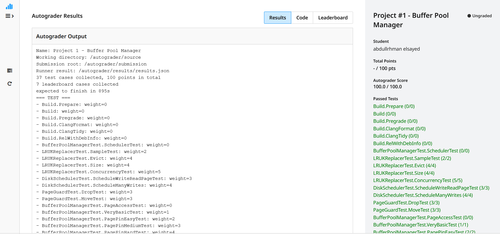
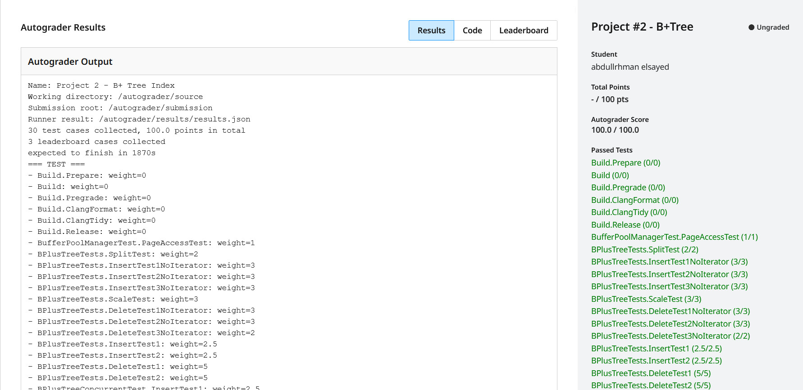
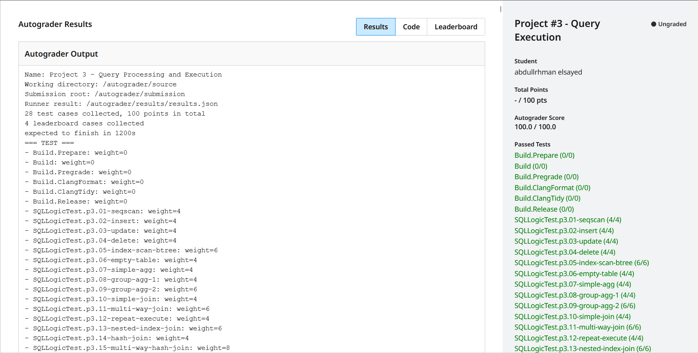

# **Project #1 - Buffer Pool Manager**
Implement [Buffer Pool Manager](https://15445.courses.cs.cmu.edu/fall2024/project1/) with LRU-K, Disk Scheduler, and Page Guards
- **LRU-K Replacement Policy**: Built a thread-safe eviction mechanism that tracks page access history using backward k-distance to intelligently select victims when memory is full, maintaining separate tracking for frames with fewer than k accesses.
- **Disk Scheduler**: Designed a concurrent request queue with background worker thread to asynchronously process disk I/O operations (reads/writes), providing non-blocking I/O through promise/future synchronization.
- **Buffer Pool Manager**: Integrated the LRU-K replacer and disk scheduler to manage in-memory page frames, handle page pinning/unpinning with atomic reference counts, and maintain a page-to-frame mapping table for efficient lookups.

-----
# **Project #2 - B+Tree**
Implement [B+Tree Index](https://15445.courses.cs.cmu.edu/fall2024/project2/) with Concurrent Operations and Iterator Support
- **B+Tree Page Structures**: Implemented three core page types (base, internal, and leaf pages) with proper memory layout and type-specific operations. Internal pages store separator keys and child pointers, while leaf pages store actual key-value pairs with sibling pointers for efficient traversal.
- **B+Tree Core Operations**: Built insertion, deletion, and point search functionality that maintains B+Tree invariants through automatic node splitting and merging. The implementation handles node splits/merges, redistributes keys during underflow, and updates separator keys to maintain correct routing. All operations support unique keys and provide O(log n) performance.
- **Index Iterator**: Designed a iterator that enables efficient in-order scans through the B+Tree by following leaf page sibling pointers.
- **Concurrency Control**: Implemented thread-safe concurrent operations using the latch crabbing protocol, where threads acquire write locks during traversal and release ancestor locks as soon as it's safe to do so. This prevents deadlocks while maintaining high concurrency during mixed insert/delete workloads across multiple threads.

---
# **Project #3 - Query Execution**
Implement [Query Execution](https://15445.courses.cs.cmu.edu/fall2024/project3/) with Volcano Model Executors, Query Optimizations, and External Sorting
- **Access Methods & Index Optimizations:** Implemented core table modification executors (Insert, Update, Delete) and SeqScan, ensuring all B+Tree index structures are correctly maintained via the System Catalog. Developed IndexScan for efficient point lookups and ordered scans, alongside an optimizer rule to automatically push down predicates and transform SeqScans into IndexScans when applicable.
- **Aggregation & Nested Joins:** Built an Aggregation executor using an in-memory hash table to compute GROUP BY queries with various aggregate functions. Implemented NestedLoopJoin and NestedIndexJoin executors to handle inner and left outer joins, leveraging index probes for the inner table when an equi-join condition matches an available index.
- **HashJoin & Query Optimization:** Developed a high-performance HashJoin executor utilizing an in-memory hash table to process conjunctions of equi-conditions. Implemented an optimizer rule to automatically transform NestedLoopJoins into HashJoins when multiple equality predicates are detected, significantly accelerating join operations.
- **External Merge Sort & Limit:** Engineered an External Merge Sort executor capable of sorting datasets larger than available memory using a custom SortPage layout and a 2-way merge algorithm. Managed complex buffer pool interactions and page lifecycles, including a robust cleanup mechanism to prevent disk leaks during early query termination (e.g., when paired with the Limit executor).

---